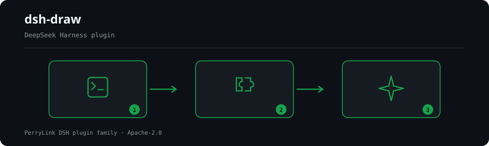

<div align="center">

# 🎨 dsh-draw

> 🧊 **FROZEN since 2026-10-05** — only real breakages are fixed. Prefer the better-adopted alternative recorded below.
- **1024 store channel**: `npm i -g dsh1024` once, then `dsh1024 plugin --profile web add dsh-draw` (counts toward the [deepseek1024.com](https://deepseek1024.com) install ranking).
[](https://gitee.com/perrylink/dsh-draw)
[](https://dshfind.com/plugins/PerryLink/dsh-draw?ref=badge)
[](https://api.securityscorecards.dev/projects/github.com/PerryLink/dsh-draw)

**Unified static-image generation routing for DeepSeek Harness.**

*One tool, many engines — health-aware fallback, durable results, counted usage.*

[](LICENSE)
[](https://github.com/topics/dsh-plugin)
[](https://github.com/PerryLink/dsh-plugin-doctor#verified-徽章)
[](https://dsh.market/)
[](#)
[](https://github.com/PerryLink/dsh-draw/actions)
[](https://github.com/PerryLink/dsh-draw/releases)
[](https://www.npmjs.com/package/dsh-draw)
[](https://www.npmjs.com/package/dsh-draw)

[English](README.md) · [简体中文](README-zh.md) · [Español](README-es.md) · [Português](README-pt.md) · [हिन्दी](README-hi.md)

```sh
dsh plugin --profile <name> add dsh-draw
```


</div>

---

**📖 Ecosystem knowledge base** — measured data, not marketing: [plugin development guide · plugin-selection data · maintenance criteria](https://perrylink.github.io/dsh-plugin-guide/).

<!-- star-cta -->
## Install & uninstall

- **git channel** (latest `main`): `dsh plugin --profile web add github:PerryLink/dsh-draw` — the `prepare` script builds with production dependencies only.
- **npm channel** (published releases): `dsh plugin --profile web add dsh-draw`.
- **tarball channel**: `pnpm pack` in this repo, then `dsh plugin --profile web add ./dsh-draw-<version>.tgz`.
- **uninstall**: `dsh plugin --profile web remove dsh-draw` (or remove the row from the profile patch).

> If pnpm reports `ERR_PNPM_IGNORED_BUILDS` for this package (esbuild's harmless platform-binary validation), add `allowBuilds: { esbuild: true }` to your `pnpm-workspace.yaml` — the `dsh` CLI prints the exact snippet.

## ⭐ 如果它帮到了你

这个插件是 [DSH 插件家族](https://github.com/PerryLink)的一员（95 个，全部 Apache-2.0）。如果你在用，**给个 star** —— 它不会解锁任何功能，但会让下一个人在搜索里更容易找到它。

*English:* part of a 95 plugin family for DeepSeek Harness. If it is useful, **a star helps the next person find it** — nothing is gated behind it.


## What is dsh-draw?

Unified static-image generation routing for DeepSeek Harness.

One tool, many engines — health-aware fallback, durable results, counted usage.



*Workflow overview: call → plugin → result. The examples below use the real command surface.*


## Maintenance status: 🧊 FROZEN

> **Frozen on 2026-10-05. No new features.** This package still works, and it is not retired — but it no longer receives feature work. Only a genuine breakage will be fixed.

Maintainers treat this capability as one where **better-adopted alternatives now exist**, so effort has moved elsewhere. The comparison below was measured on 2026-10-05 and is recorded so nobody has to redo it.

| | package | weekly downloads |
|---|---|---|
| **this package** | `dsh-draw` | 973 |
| better-adopted alternative | [`dsh-image-gen`](https://github.com/shanliuling/dsh-image-gen) | **7,216** |
| another alternative | `@goodandready/dsh-image-gen` | 4,822 |

**Why the alternative leads.** `dsh-image-gen` provides Gemini, OpenAI, Seedream, DashScope and a local ComfyUI in one plugin.

**Compatibility.** declares no dsh peers, so the compatibility guard never blocks it.

👉 **For new work, prefer dsh-image-gen.** Existing installs keep working unchanged; nothing is being removed.

*Full evidence, including the host-version compatibility matrix: `dsh-plugin-supersession-review-20261005.md`.*

## Comparison


measured 2026-10-05 · from the README's FROZEN maintenance table (npm weekly downloads)

## Compatibility

| Surface | Status |
|---|---|
| Harness | DeepSeek Harness `dsh-v0.2.1-alpha.1` (compat declared for `0.1.5-rc.2`) |
| Node | `^22.19.0 \|\| >=24.0.0` |
| Engines | Any OpenAI-compatible images endpoint; presets for OpenAI Images (`gpt-image-1`) and Zhipu CogView (`cogview-3-flash`) |
| Surfaces | Host `image_generate` tool + web result card + Plugins settings tab |

The browser half rides the cordis `Context` and the published client packages (`dsh-client-ui-slots`, `dsh-client-ui-settings`, `dsh-client-ui-tool`, `dsh-client-locale`, `dsh-client-connection`); it no longer depends on the removed `dsh-client-runtime` package (the tool-call block is read through a local structural contract), so the client surface also lines up with `0.1.2-rc.1` hosts.
0.1.2-rc.1 (adapted 2026-09-02): the session envelope keeps its ignorable field for stored-log read compatibility only - Session.append still cannot stamp it, so audit-gate behavior is unchanged. Verified 2026-09-06 against the dsh-v0.1.7-alpha.1 master checkout (full gate chain + profile install smoke).
0.1.6-alpha.2 (adapted 2026-09-18): `Session.append`'s third parameter exists only for surface-eligible event types and is a `SurfaceIntent`, never an `ignorable` envelope, so `draw/generated` (a non-surface type) is still not written on this line — quota is counted in memory per session and resets when the session restarts, exactly as the "Quota durability" note below describes. Verified 2026-09-18 (dual typecheck rulers + the full suite + self-contained/artifacts/readme gates).
0.1.7-rc.2 (adapted 2026-10-04): the client `tool.call.toolview` contract split its owner into three stages (`preparing` / `start` / `result`), and a keyed card is now dispatched while the arguments are still streaming. The result card therefore also renders the in-flight row for those earlier stages — an occupied keyed slot never reaches the host's own generic row, so answering a prepared stage with nothing blanked the line for the whole streaming window. Nothing else changed: the settled card, the accounting line, and regenerate behave exactly as before. Verified 2026-09-23 (dual typecheck rulers + the full suite + the new host-contract gate).

## What you get

`dsh-draw` gives the harness one unified `image_generate` tool with standard parameters (`prompt`/`size`/`count`/`quality`/`style`/`engine`) that are translated per engine:

- **Multi-engine routing** — a config-driven chain (OpenAI Images, Zhipu CogView, or any OpenAI-compatible endpoint) walked top-down with **health-aware fallback**: consecutive failures push an engine into cooldown, and the next healthy engine serves the call.
- **Durable results** — generated images are saved as workspace attachments (content-addressed, under the harness's attachment policy) and returned as canonical file references.
- **Quota accounting** — per-session caps on generation calls and image bytes, folded from the durable session log and enforced before engine spend and before storage.
- **Credentials as references** — engine API keys are environment-variable names resolved per call through the official `ctx.credentials` seam; literal keys are never stored in configuration and never logged.
- **Web surfaces** — an in-conversation result card (images, engine, quota, one-click regenerate) and a Plugins settings tab (engine chain, credential status, probes, quota limits).

```text
model                           harness
  │ image_generate {prompt, ...} ──▶ validate ──▶ quota check ──▶ router
  │                                  openai ──(fail)──▶ cogview ──▶ images
  │ ◀── canonical JSON + image blocks (durable attachment refs)
  │                       └── draw/generated session event (quota + audit)
```

## Quick start

```sh
dsh plugin --profile web add github:PerryLink/dsh-draw
```

```sh
# 1. install the bundle into your profile
dsh plugin --profile web add github:PerryLink/dsh-draw

# or from npm (published releases)
dsh plugin --profile web add dsh-draw

# 2. provide the engine keys as credential references (environment variables)
#    OPENAI_API_KEY and/or ZHIPU_API_KEY — never in the profile patch

# 3. restart and verify the row
dsh --profile web --dump-config | grep -A2 'id: dsh-draw'
```

Then ask the agent to draw:

```
> Draw a 1536x1024 landscape of a lighthouse at dusk, vivid style.
```

### Examples

These are the plugin's real entry points; install once, then call one.

#### Detailed example

**Command**

~~~sh
image_generate
~~~

**Input**

~~~json
{
  "prompt": "a cat"
}
~~~

**Output**

~~~text
{
  "ok": true,
  "engine": "openai",
  "images": [
    { "attachmentId": "att-1" }
  ]
}
~~~

*Observed from `plugins/dsh-draw/tests/index.spec.ts:50-66; same fields asserted at plugins/dsh-draw/tests/drawer.spec.ts:59-69`*

#### Brief examples


## Configuration

All tunables are Schemastery `Config` fields (changeable from cordis.yml). An id-targeted override replaces the whole row — restate every key you need. `cordis.patch.yml` documents each key inline.

| Key | Default | Meaning |
|---|---|---|
| `engines` | OpenAI + CogView presets | Ordered engine chain, walked top-down with fallback; each entry: `id`, `baseUrl` (no credentials), `model`, `apiKeyRef` (env-var name), `provider` (`openai`/`replicate`/`fal`, default `openai`), `enabled`, `sizeMap`, `qualitySupported`, `styleSupported`, `responseFormat` (`b64_json`/`url`), `imageMediaType` |
| `defaultEngine` | `openai` | Engine id the router prefers; must name a configured engine |
| `requestTimeoutMs` | `120000` | Per-generation HTTP timeout (1000..600000) |
| `maxImagesPerCall` | `4` | Cap on images one call may produce (1..10) |
| `maxPromptLength` | `4000` | Prompt length cap in characters (1..32000) |
| `maxGenerationsPerSession` | `200` | Per-session generation-call cap (1..100000) |
| `maxBytesPerSession` | `209715200` | Per-session image-byte cap (1048576..4294967296) |
| `failureThreshold` | `2` | Consecutive failures before an engine enters cooldown (1..10) |
| `cooldownMs` | `60000` | Engine cooldown after the threshold trips (1000..3600000) |

Example override in your profile patch:

```yaml
- insert:
    - id: dsh-draw
      name: dsh-draw
      config:
        defaultEngine: cogview
        maxImagesPerCall: 2
```

## Tools & surfaces

| Surface | Notes |
|---|---|
| `image_generate` | Standard parameters; returns canonical JSON (engine/model/size, image references, quota, fallback flag, attempts) plus image content blocks |
| Result card (`tool.call.toolview`, key `image_generate`) | In every stage of the call: an in-flight row while the arguments stream, then images, engine/quota line, and one-click regenerate once it settles (full drawer path: quota + routing + audit) |
| Settings tab (Plugins → Image generation) | Engine chain, credential status, set/remove API keys (credential references), connectivity probes, quota limits |

## Permissions & data

- **Permissions**: the plugin makes outbound HTTPS calls to the configured engine endpoints only; every other surface is read-only. The settings tab's only writes are credential set/remove calls on the official `ctx.credentials` seam.
- **Data**: generated images are saved through the official attachment store under the harness's own attachment policy. Quota usage is folded from the `draw/generated` session events, plus the in-memory fallback ledger on hosts that cannot log those events — nothing else is stored.
- **Session log**: the `draw/generated` event records engine, model, standardized request, byte totals, and attachment ids — the audit facts, never the API keys. The event is appended only when the host knows the type or honors the `ignorable` envelope (probed at mount); on rc.6/rc.7 hosts and the `0.1.2-rc.1` line (whose `Session.append` cannot stamp the marker and which fails closed on unknown types at read) the payload goes to the in-memory fallback ledger instead, so generating images can no longer make a session refuse to reopen.

## Security boundaries

- **Credential references, never literals.** `apiKeyRef` names an environment variable; a `baseUrl` embedding credentials fails the load loudly.
- **Sanitized display.** URLs, probe notes, and error text are redacted (userinfo passwords, credential query values, bearer tokens, JWTs) before any display or log.
- **Quota before spend.** Generation and byte caps are checked before engine calls and before attachment storage; exhausted sessions fail fast without spending engine credits.
- **Fail loud, fall back deliberately.** Malformed responses surface as structured errors; a failing engine is skipped after its cooldown threshold, and a fully exhausted chain returns the complete attempt record instead of pretending success.

## Known limitations

- **Image models only.** No video, audio, or edit endpoints; no vision understanding.
- **Engine compatibility.** Three vocabularies are supported through the provider seam: `openai` (the `POST /images/generations` shape), `replicate` (prediction create + poll), and `fal` (the `fal.run` queue). Provider-specific extras beyond `prompt`/size/count (e.g. seed, scheduler) are out of scope.
- **Cost awareness is structural.** The plugin counts calls and bytes but does not know engine pricing — pair with `dsh-budget` for cost governance.
- **Quota durability on rc.6/rc.7, 0.1.2-rc.1 and 0.1.6-alpha.2.** On hosts whose session log cannot carry `draw/generated` (static event whitelist, no `ignorable` envelope; `0.1.2-rc.1` cannot stamp the marker and fails closed on unknown event types at read; on `0.1.6-alpha.2` the append's third parameter is a `SurfaceIntent` for surface types only, so a non-surface event cannot be marked), quota stays exact for the live session from the in-memory fallback ledger but resets on restart; durable accounting resumes on hosts with a plugin event surface. The first refused commit warns once, so a degraded session is visible instead of silent.

## Development

```sh
pnpm install        # node ^22.19 || >=24
pnpm run typecheck  # tsc: src + tests against the local harness checkout
pnpm run typecheck:ci  # tsc against the published 0.1.7-rc.2 faces (no paths)
pnpm test           # vitest: 19 spec files (scripted transport, real Context/Session/ToolRuntime)
pnpm run build      # tsc declarations + tsdown bundles (lib/)
pnpm run verify:self-contained  # dependency specs resolve from the registry
pnpm run verify:host-contract   # the host tool-view contract still matches what this plugin declares
pnpm run verify:artifacts       # host ESM face + typert manifest + browser bundle + config files
pnpm pack           # the published tarball
```

## Topics

`dsh`, `dsh-plugin`, `deepseek-harness`, `deepseek`, `cordis`, `image-generation`, `openai-images`, `cogview`, `zhipu`, `text-to-image`

## Contributors

- [@PerryLink](https://github.com/PerryLink) — creator and maintainer: engine router, drawer, quota accounting, Typert wire vocabulary, browser half, and the five-language docs.
- [@Mohei-Muun](https://github.com/Mohei-Muun) — reported the `draw/generated` session-log unload bug on rc.7 hosts ([#2](https://github.com/PerryLink/dsh-draw/issues/2)), which led to the adaptive event gate.

## PerryLink DSH Plugin Family

This project is part of the DeepSeek Harness plugin family from [PerryLink](https://github.com/PerryLink). The roster stays collapsed below so every README keeps a short first screen; expand it to see every row and its status.

<details>
<summary>Expand all plugins</summary>

| Plugin | Status |
|---|---|
| **[dsh-aqua-input-check](https://github.com/PerryLink/dsh-aqua-input-check)** |  |
| **[dsh-archive-check](https://github.com/PerryLink/dsh-archive-check)** |  |
| **[dsh-auto-review](https://github.com/PerryLink/dsh-auto-review)** |  |
| **[dsh-autotier](https://github.com/PerryLink/dsh-autotier)** |  |
| **[dsh-bid-ca-precheck](https://github.com/PerryLink/dsh-bid-ca-precheck)** |  |
| **[dsh-bid-qual-check](https://github.com/PerryLink/dsh-bid-qual-check)** |  |
| **[dsh-cert-mcp](https://github.com/PerryLink/dsh-cert-mcp)** |  |
| **[dsh-checkpoint-rewind](https://github.com/PerryLink/dsh-checkpoint-rewind)** |  |
| **[dsh-click](https://github.com/PerryLink/dsh-click)** |  |
| **[dsh-composer-history](https://github.com/PerryLink/dsh-composer-history)** |  |
| **[dsh-contract-stance](https://github.com/PerryLink/dsh-contract-stance)** |  |
| **[dsh-customs-doc-check](https://github.com/PerryLink/dsh-customs-doc-check)** |  |
| **[dsh-data-quality](https://github.com/PerryLink/dsh-data-quality)** |  |
| **[dsh-demurrage-ledger](https://github.com/PerryLink/dsh-demurrage-ledger)** |  |
| **[dsh-doublecheck](https://github.com/PerryLink/dsh-doublecheck)** |  |
| **[dsh-drill-script-check](https://github.com/PerryLink/dsh-drill-script-check)** |  |
| **[dsh-eia-guide-check](https://github.com/PerryLink/dsh-eia-guide-check)** |  |
| **[dsh-emergency-plan](https://github.com/PerryLink/dsh-emergency-plan)** |  |
| **[dsh-essay-rubric-check](https://github.com/PerryLink/dsh-essay-rubric-check)** |  |
| **[dsh-evidence-check](https://github.com/PerryLink/dsh-evidence-check)** |  |
| **[dsh-export-ctl-check](https://github.com/PerryLink/dsh-export-ctl-check)** |  |
| **[dsh-fast](https://github.com/PerryLink/dsh-fast)** |  |
| **[dsh-fmea-table-check](https://github.com/PerryLink/dsh-fmea-table-check)** |  |
| **[dsh-forecast-penalty](https://github.com/PerryLink/dsh-forecast-penalty)** |  |
| **[dsh-fund-research](https://github.com/PerryLink/dsh-fund-research)** |  |
| **[dsh-github](https://github.com/PerryLink/dsh-github)** |  |
| **[dsh-gongwen-flow-check](https://github.com/PerryLink/dsh-gongwen-flow-check)** |  |
| **[dsh-gongwen-word-check](https://github.com/PerryLink/dsh-gongwen-word-check)** |  |
| **[dsh-guard-plan-qc](https://github.com/PerryLink/dsh-guard-plan-qc)** |  |
| **[dsh-hazchem-check](https://github.com/PerryLink/dsh-hazchem-check)** |  |
| **[dsh-hazplan-check](https://github.com/PerryLink/dsh-hazplan-check)** |  |
| **[dsh-hidden-risk-map](https://github.com/PerryLink/dsh-hidden-risk-map)** |  |
| **[dsh-hs-classify](https://github.com/PerryLink/dsh-hs-classify)** |  |
| **[dsh-icd-rule-check](https://github.com/PerryLink/dsh-icd-rule-check)** |  |
| **[dsh-industry-research](https://github.com/PerryLink/dsh-industry-research)** |  |
| **[dsh-lawcite-adapter](https://github.com/PerryLink/dsh-lawcite-adapter)** |  |
| **[dsh-laya](https://github.com/PerryLink/dsh-laya)** |  |
| **[dsh-lc-doc-check](https://github.com/PerryLink/dsh-lc-doc-check)** |  |
| **[dsh-learning-gap-check](https://github.com/PerryLink/dsh-learning-gap-check)** |  |
| **[dsh-library](https://github.com/PerryLink/dsh-library)** |  |
| **[dsh-local-ai](https://github.com/PerryLink/dsh-local-ai)** |  |
| **[dsh-lsp-actions](https://github.com/PerryLink/dsh-lsp-actions)** |  |
| **[dsh-mask](https://github.com/PerryLink/dsh-mask)** |  |
| **[dsh-mcp-panel](https://github.com/PerryLink/dsh-mcp-panel)** |  |
| **[dsh-medrec-qc](https://github.com/PerryLink/dsh-medrec-qc)** |  |
| **[dsh-memento](https://github.com/PerryLink/dsh-memento)** |  |
| **[dsh-nsfc-form-check](https://github.com/PerryLink/dsh-nsfc-form-check)** |  |
| **[dsh-nurse-record-check](https://github.com/PerryLink/dsh-nurse-record-check)** |  |
| **[dsh-observe](https://github.com/PerryLink/dsh-observe)** |  |
| **[dsh-origin-rvc-check](https://github.com/PerryLink/dsh-origin-rvc-check)** |  |
| **[dsh-ota-review-check](https://github.com/PerryLink/dsh-ota-review-check)** |  |
| **[dsh-output-styles](https://github.com/PerryLink/dsh-output-styles)** |  |
| **[dsh-paper-doc-adapter](https://github.com/PerryLink/dsh-paper-doc-adapter)** |  |
| **[dsh-permission-rules](https://github.com/PerryLink/dsh-permission-rules)** |  |
| **[dsh-permit-report-check](https://github.com/PerryLink/dsh-permit-report-check)** |  |
| **[dsh-pipeline-check](https://github.com/PerryLink/dsh-pipeline-check)** |  |
| **[dsh-pleading-draft](https://github.com/PerryLink/dsh-pleading-draft)** |  |
| **[dsh-plugin-doctor](https://github.com/PerryLink/dsh-plugin-doctor)** |  |
| **[dsh-plugin-guide](https://github.com/PerryLink/dsh-plugin-guide)** |  |
| **[dsh-plugin-kit](https://github.com/PerryLink/dsh-plugin-kit)** |  |
| **[dsh-plugin-upgrade](https://github.com/PerryLink/dsh-plugin-upgrade)** |  |
| **[dsh-policy-brief-draft](https://github.com/PerryLink/dsh-policy-brief-draft)** |  |
| **[dsh-power-loss-split](https://github.com/PerryLink/dsh-power-loss-split)** |  |
| **[dsh-power-ticket-check](https://github.com/PerryLink/dsh-power-ticket-check)** |  |
| **[dsh-ppap-check](https://github.com/PerryLink/dsh-ppap-check)** |  |
| **[dsh-protest-deadline](https://github.com/PerryLink/dsh-protest-deadline)** |  |
| **[dsh-railway-window](https://github.com/PerryLink/dsh-railway-window)** |  |
| **[dsh-repair-order-qc](https://github.com/PerryLink/dsh-repair-order-qc)** |  |
| **[dsh-research-report](https://github.com/PerryLink/dsh-research-report)** |  |
| **[dsh-review-reply-check](https://github.com/PerryLink/dsh-review-reply-check)** |  |
| **[dsh-rulefile-check](https://github.com/PerryLink/dsh-rulefile-check)** |  |
| **[dsh-safety-brief-check](https://github.com/PerryLink/dsh-safety-brief-check)** |  |
| **[dsh-score](https://github.com/PerryLink/dsh-score)** |  |
| **[dsh-session-sync](https://github.com/PerryLink/dsh-session-sync)** |  |
| **[dsh-site-log-check](https://github.com/PerryLink/dsh-site-log-check)** |  |
| **[dsh-skill-pack-security](https://github.com/PerryLink/dsh-skill-pack-security)** |  |
| **[dsh-soe-decision-check](https://github.com/PerryLink/dsh-soe-decision-check)** |  |
| **[dsh-soilwater-check](https://github.com/PerryLink/dsh-soilwater-check)** |  |
| **[dsh-sop-sync-check](https://github.com/PerryLink/dsh-sop-sync-check)** |  |
| **[dsh-spc-gbt-adapter](https://github.com/PerryLink/dsh-spc-gbt-adapter)** |  |
| **[dsh-talk](https://github.com/PerryLink/dsh-talk)** |  |
| **[dsh-tender-extract](https://github.com/PerryLink/dsh-tender-extract)** |  |
| **[dsh-tender-matrix](https://github.com/PerryLink/dsh-tender-matrix)** |  |
| **[dsh-test-drive](https://github.com/PerryLink/dsh-test-drive)** |  |
| **[dsh-ticktick](https://github.com/PerryLink/dsh-ticktick)** |  |
| **[dsh-translate](https://github.com/PerryLink/dsh-translate)** |  |
| **[dsh-warranty-calc](https://github.com/PerryLink/dsh-warranty-calc)** |  |
| **[dsh-budget](https://github.com/PerryLink/dsh-budget)** | 🧊 FROZEN — see the repo README |
| **[dsh-claude-move](https://github.com/PerryLink/dsh-claude-move)** | 🧊 FROZEN — see the repo README |
| **[dsh-defend](https://github.com/PerryLink/dsh-defend)** | 🧊 FROZEN — see the repo README |
| **[dsh-draw](https://github.com/PerryLink/dsh-draw)** | 🧊 FROZEN — see the repo README |
| **[dsh-reach](https://github.com/PerryLink/dsh-reach)** | 🧊 FROZEN — see the repo README |
| **[dsh-background-agents](https://github.com/PerryLink/dsh-background-agents)** | 🚫 RETIRED — see the repo README |
| **[dsh-session-pin](https://github.com/PerryLink/dsh-session-pin)** | 🚫 RETIRED — see the repo README |
| **[dsh-team-rooms](https://github.com/PerryLink/dsh-team-rooms)** | 🚫 RETIRED — see the repo README |

</details>

## License

[Apache License 2.0](LICENSE) © 2026 dsh-draw contributors
